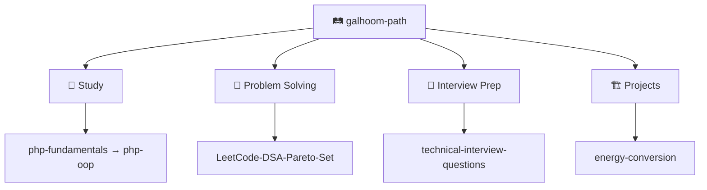

**Backend engineer** — PHP, Laravel, REST APIs, and domain logic for production backends.

[🔗 LinkedIn](https://www.linkedin.com/in/abdelrahman-galhoom/) · [🛤️ Galhoom Path](https://github.com/galhoom-path)

---

## 🔭 Current focus

**Energy Conversion & Metering** — Laravel API for meters, tariffs, billing, and reconciliation.

---

## 💼 Selected work

| | Repository | Scope |
|:---:|:---|:---|
| 🏗️ | [energy-conversion](https://github.com/galhoom-path/energy-conversion) | Metering & billing API (Laravel) |
| 🗂️ | [job-board-platform](https://github.com/Galhoom22/job-board-platform) | Recruitment platform — candidate & company flows |
| 🎤 | [technical-interview-questions](https://github.com/galhoom-path/technical-interview-questions) | PHP / Laravel interview Q&A from real interviews |

---

## 🛤️ Galhoom Path

**Study** · **Problem Solving** · **Interview Prep** · **Projects**

[Open organization →](https://github.com/galhoom-path)

---

## 🛠️ Stack

`PHP` · `Laravel` · `MySQL` · `REST APIs` · `Livewire` · `Filament` · `Git` · `Postman`
