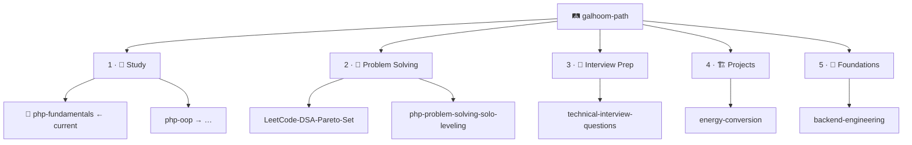

**Backend engineer** — PHP, Laravel, REST APIs, and domain logic for production backends.

[🔗 LinkedIn](https://www.linkedin.com/in/abdelrahman-galhoom/) · [🛤️ Galhoom Path](https://github.com/galhoom-path)

---

### Contents

| # | Section |
|:---:|:---|
| **1** | [Current focus](#1--current-focus) |
| **2** | [Selected work](#2--selected-work) |
| **3** | [Galhoom Path](#3--galhoom-path) |
| **4** | [Stack](#4--stack) |

---

## 1 · Current focus

**📘 [php-fundamentals](https://github.com/galhoom-path/php-fundamentals)** — Track 1 · Study · Learning Series #1  
Core PHP 8.5+ (no OOP) · Lectures → Interview Questions → Final Project · **0 / 30** lectures

> Other [Galhoom Path](https://github.com/galhoom-path) tracks resume **after** this repo is complete.

---

## 2 · Selected work

| # | | Repository | Scope |
|:---:|:---:|:---|:---|
| **1** | 📘 | [php-fundamentals](https://github.com/galhoom-path/php-fundamentals) | **Current focus** — PHP 8.5+ fundamentals (Study #1) |
| **2** | 🏗️ | [energy-conversion](https://github.com/galhoom-path/energy-conversion) | Metering & billing API (Laravel) |
| **3** | 🗂️ | [job-board-platform](https://github.com/Galhoom22/job-board-platform) | Recruitment platform — candidate & company flows |
| **4** | 🎤 | [technical-interview-questions](https://github.com/galhoom-path/technical-interview-questions) | PHP / Laravel interview Q&A from real interviews |
| **5** | 🧭 | [backend-engineering](https://github.com/galhoom-path/backend-engineering) | Track 5 · Foundations — stack-agnostic backend notes |

---

## 3 · Galhoom Path

| # | Track |
|:---:|:---|
| **1** | 📘 Study |
| **2** | 🧠 Problem Solving |
| **3** | 🎤 Interview Prep |
| **4** | 🏗️ Projects |
| **5** | 🧭 Foundations |

[Open organization →](https://github.com/galhoom-path) · [Path progress →](https://github.com/galhoom-path#2--path-progress)

---

## 4 · Stack

`PHP` · `Laravel` · `MySQL` · `REST APIs` · `Livewire` · `Filament` · `Git` · `Postman`
