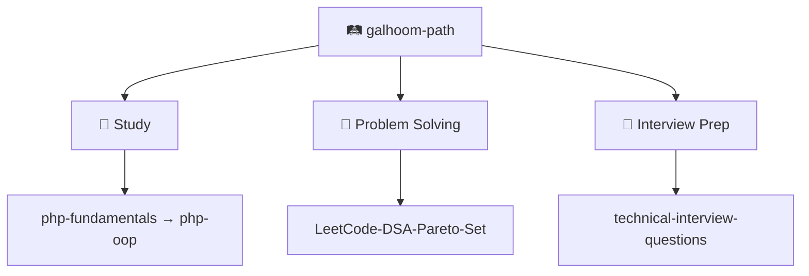

I debug backends like a **detective**. **T-shaped** skills. **Product-engineer** mindset.

[LinkedIn](https://www.linkedin.com/in/abdelrahman-galhoom/) · [🛤️ Galhoom Path](https://github.com/galhoom-path)

---

## 🔭 Now

**Energy Conversion & Metering** API — Laravel · Clean Architecture · real domain flows.

---

## 🛤️ Galhoom Path

Structured learning I maintain in public — for myself and for others:

[Open the organization →](https://github.com/galhoom-path)

---

## 🛠️ Stack

`PHP 8.5` · `Laravel 13` · `MySQL` · `Livewire` · `Filament` · `Git` · `Postman`
