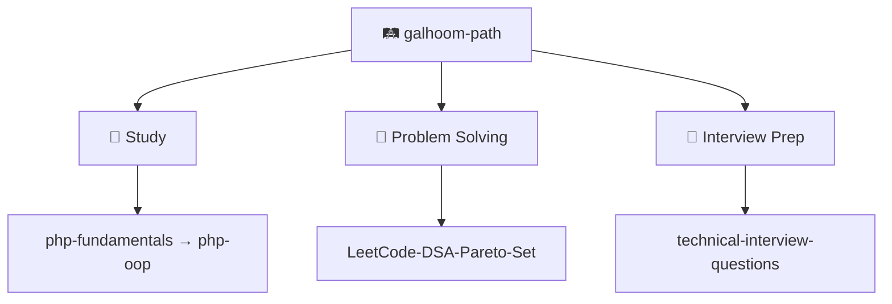

I debug backends like a **detective**. **T-shaped** skills. **Product-engineer** mindset.

[LinkedIn](https://www.linkedin.com/in/abdelrahman-galhoom/) · [🛤️ Galhoom Path](https://github.com/galhoom-path)

---

## 🔭 Now

Shipping an **Energy Conversion & Metering** API — Laravel · domain modules · real billing flows.

---

## 💼 Featured work

| Project | What a visitor sees |
|:---|:---|
| [⚡ energy-conversion](https://github.com/Galhoom22/energy-conversion) | Metering → tariffs → billing → reconciliation (Laravel API) |
| [🚀 job-board-platform](https://github.com/Galhoom22/job-board-platform) | Job board monorepo — seekers + companies (Clean Architecture) |
| [🎤 technical-interview-questions](https://github.com/galhoom-path/technical-interview-questions) | Real PHP/Laravel interview answer bank (not a scraped dump) |

---

## 🛤️ Galhoom Path

Public learning system I maintain — Study · Problem Solving · Interview Prep:

[Open the organization →](https://github.com/galhoom-path)

---

## 🛠️ Stack

`PHP 8.5` · `Laravel 13` · `MySQL` · `Livewire` · `Filament` · `Git` · `Postman`
