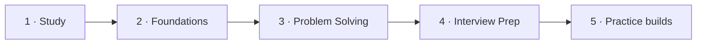
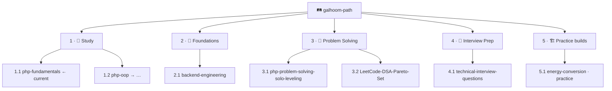

**Backend engineer** — PHP, Laravel, REST APIs, and domain logic for production backends.

[🔗 LinkedIn](https://www.linkedin.com/in/abdelrahman-galhoom/) · [🛤️ Galhoom Path](https://github.com/galhoom-path)

---

### Contents

| # | Section |
|:---:|:---|
| **1** | [Current focus](#1--current-focus) |
| **2** | [Selected work](#2--selected-work) |
| **3** | [Galhoom Path](#3--galhoom-path) |
| **4** | [Stack](#4--stack) |

---

## 1 · Current focus

**1.1 · 📘 [php-fundamentals](https://github.com/galhoom-path/php-fundamentals)** — Track 1 · Study · Learning Series #1  

| | |
|:---|:---|
| **Progress** | **0 / 30** lectures · `[░░░░░░░░░░░░░░░░░░░░] **0%**` |
| **Complete?** | ⬜ **Not finished** (`✅` only at **100%**) |
| **Journey** | **1 Study → 2 Foundations → 3 Solve → 4 Interview → 5 Practice builds** |
| **Rule** | Other Galhoom Path IDs resume **after 1.1** |
| **Living updates** | Even after `✅`, repos keep getting version bumps in-place (e.g. PHP **8.5 → 8.6**) |

> **No Galhoom Path repo is `✅` yet.** Published content ≠ finished.

---

## 2 · Selected work

Ordered by Galhoom Path ID where applicable. **Complete? = `✅` only at 100%.**

| # | ID | Repository | Progress | Complete? | Scope |
|:---:|:---:|:---|:---:|:---:|:---|
| **1** | **1.1** | [php-fundamentals](https://github.com/galhoom-path/php-fundamentals) | **0%** | ⬜ | 🎯 **Current focus** — PHP 8.5+ fundamentals |
| **2** | **2.1** | [backend-engineering](https://github.com/galhoom-path/backend-engineering) | **0%** | ⬜ | Track 2 · Foundations — stack-agnostic notes |
| **3** | **4.1** | [technical-interview-questions](https://github.com/galhoom-path/technical-interview-questions) | **0%** | ⬜ | Track 4 · PHP / Laravel interview Q&A |
| **4** | **5.1** | [energy-conversion](https://github.com/galhoom-path/energy-conversion) | **~20%** | ⬜ | Track 5 · Practice build (learn by doing) — metering & billing API |
| **5** | — | [job-board-platform](https://github.com/Galhoom22/job-board-platform) | — | ⬜ | Personal · Recruitment platform (candidate & company flows) |

---

## 3 · Galhoom Path

**One pipeline** — each track builds on the previous:

| Track # | Track | Repo IDs | Role |
|:---:|:---|:---|:---|
| **1** | 📘 Study | **1.1 → 1.2 → …** | Learn to write code |
| **2** | 🧭 Foundations | **2.1** | Shared backend concepts |
| **3** | 🧠 Problem Solving | **3.1 → 3.2** | PHP gates → LeetCode patterns |
| **4** | 🎤 Interview Prep | **4.1** | Real interview answers |
| **5** | 🏗️ Projects | **5.1** | Learn-by-doing practice builds (public · not market products · requirements-first) |

> Track **5** is public **learn by doing** (not market products). Real commercial work stays private. Each practice repo ships **requirements** (written and/or API contract).

[Open organization →](https://github.com/galhoom-path) · [Path progress →](https://github.com/galhoom-path#2--path-progress)

---

## 4 · Stack

`PHP` · `Laravel` · `MySQL` · `REST APIs` · `Livewire` · `Filament` · `Git` · `Postman`
