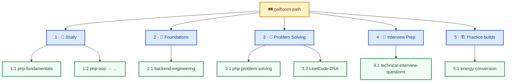
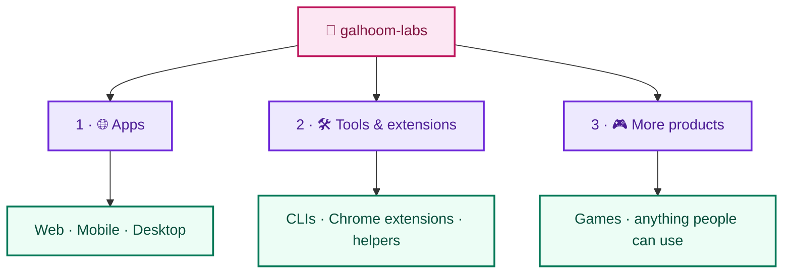

**Backend engineer** — PHP, Laravel, REST APIs, domain logic for production backends.

[🔗 LinkedIn](https://www.linkedin.com/in/abdelrahman-galhoom/)

---

I ship backend APIs and Laravel apps. This page is the overview; depth lives in each org.

## Two homes (clear split)

| Org | Promise | You open it when… |
|---|---|---|
| **[galhoom-path](https://github.com/galhoom-path)** | **Learn and progress** | You want to study, practice, and grow (curriculum + drills + practice builds) |
| **[galhoom-labs](https://github.com/galhoom-labs)** | **Real products** | You want something you can **use** — web, mobile, desktop, extension, CLI, game, or any other product |

**How to choose a home for a repo**
1. Primary goal is *your learning* → **Path**
2. Primary goal is *other people using it* → **Labs**
3. Practice builds (e.g. Track 5) stay on **Path** until they become real products.

---

### 🛤️ Galhoom Path — learn and progress

Study → Foundations → Solve → Interview → Practice.  
You come here to improve yourself — not to browse a product catalog.

**[Open galhoom-path →](https://github.com/galhoom-path)**

---

### 🧪 Galhoom Labs — real products

Websites, mobile apps, desktop apps, Chrome extensions, CLIs, games — **any real product** someone can use and benefit from.  
Not a study path. If you can install it, run it, or open it and get value, it belongs here.

**[Open galhoom-labs →](https://github.com/galhoom-labs)**

---

**Stack:** `PHP` · `Laravel` · `MySQL` · `REST APIs` · `Livewire` · `Filament` · `Git` · `Postman`
