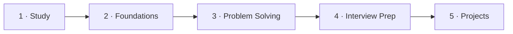
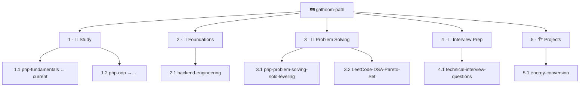

**Backend engineer** — PHP, Laravel, REST APIs, and domain logic for production backends.

[🔗 LinkedIn](https://www.linkedin.com/in/abdelrahman-galhoom/) · [🛤️ Galhoom Path](https://github.com/galhoom-path)

---

### Contents

| # | Section |
|:---:|:---|
| **1** | [Current focus](#1--current-focus) |
| **2** | [Selected work](#2--selected-work) |
| **3** | [Galhoom Path](#3--galhoom-path) |
| **4** | [Stack](#4--stack) |

---

## 1 · Current focus

**1.1 · 📘 [php-fundamentals](https://github.com/galhoom-path/php-fundamentals)** — Track 1 · Study · Learning Series #1  

| | |
|:---|:---|
| **Progress** | **0 / 30** lectures · `[░░░░░░░░░░░░░░░░░░░░] **0%**` · Complete? **⬜** |
| **Journey** | **1 Study → 2 Foundations → 3 Solve → 4 Interview → 5 Projects** |
| **Rule** | Other IDs resume **after 1.1** |
| **Completion** | **No Galhoom Path repo is `✅` yet** — published content ≠ finished. `✅` only at **100%**; repos stay **living** (e.g. PHP 8.5 → 8.6 updates in-place). |

---

## 2 · Selected work

| # | ID | Repository | Scope |
|:---:|:---:|:---|:---|
| **1** | **1.1** | [php-fundamentals](https://github.com/galhoom-path/php-fundamentals) | 🎯 **Current focus** — PHP 8.5+ fundamentals |
| **2** | **5.1** | [energy-conversion](https://github.com/galhoom-path/energy-conversion) | Track 5 · Metering & billing API (Laravel) |
| **3** | — | [job-board-platform](https://github.com/Galhoom22/job-board-platform) | Recruitment platform — candidate & company flows |
| **4** | **4.1** | [technical-interview-questions](https://github.com/galhoom-path/technical-interview-questions) | Track 4 · PHP / Laravel interview Q&A |
| **5** | **2.1** | [backend-engineering](https://github.com/galhoom-path/backend-engineering) | Track 2 · Foundations — stack-agnostic notes |

---

## 3 · Galhoom Path

**One pipeline** — each track builds on the previous:

| Track # | Track | Repo IDs | Role |
|:---:|:---|:---|:---|
| **1** | 📘 Study | **1.1 → 1.2 → …** | Learn to write code |
| **2** | 🧭 Foundations | **2.1** | Shared backend concepts |
| **3** | 🧠 Problem Solving | **3.1 → 3.2** | PHP gates → LeetCode patterns |
| **4** | 🎤 Interview Prep | **4.1** | Real interview answers |
| **5** | 🏗️ Projects | **5.1** | Ship portfolio apps |

[Open organization →](https://github.com/galhoom-path) · [Path progress →](https://github.com/galhoom-path#2--path-progress)

---

## 4 · Stack

`PHP` · `Laravel` · `MySQL` · `REST APIs` · `Livewire` · `Filament` · `Git` · `Postman`
