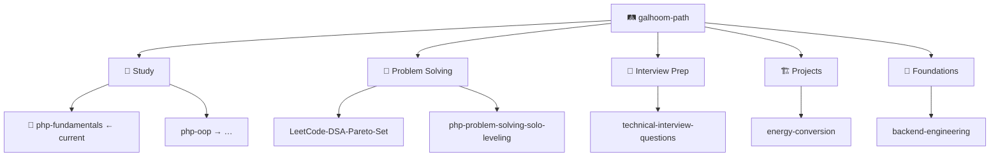

**Backend engineer** — PHP, Laravel, REST APIs, and domain logic for production backends.

[🔗 LinkedIn](https://www.linkedin.com/in/abdelrahman-galhoom/) · [🛤️ Galhoom Path](https://github.com/galhoom-path)

---

## 🔭 Current focus

**📘 [php-fundamentals](https://github.com/galhoom-path/php-fundamentals)** — Track 1 · Study · Learning Series #1  
Core PHP 8.5+ (no OOP) · Lectures → Interview Questions → Final Project · **0 / 30** lectures

> Other [Galhoom Path](https://github.com/galhoom-path) tracks resume **after** this repo is complete.

---

## 💼 Selected work

| | Repository | Scope |
|:---:|:---|:---|
| 📘 | [php-fundamentals](https://github.com/galhoom-path/php-fundamentals) | **Current focus** — PHP 8.5+ fundamentals (Study #1) |
| 🏗️ | [energy-conversion](https://github.com/galhoom-path/energy-conversion) | Metering & billing API (Laravel) |
| 🗂️ | [job-board-platform](https://github.com/Galhoom22/job-board-platform) | Recruitment platform — candidate & company flows |
| 🎤 | [technical-interview-questions](https://github.com/galhoom-path/technical-interview-questions) | PHP / Laravel interview Q&A from real interviews |
| 🧭 | [backend-engineering](https://github.com/galhoom-path/backend-engineering) | Track 5 · Foundations — stack-agnostic backend notes |

---

## 🛤️ Galhoom Path

**Study** · **Problem Solving** · **Interview Prep** · **Projects** · **Foundations**

[Open organization →](https://github.com/galhoom-path) · [Path progress →](https://github.com/galhoom-path#-path-progress)

---

## 🛠️ Stack

`PHP` · `Laravel` · `MySQL` · `REST APIs` · `Livewire` · `Filament` · `Git` · `Postman`
