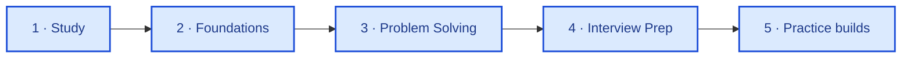

**Backend engineer** — PHP, Laravel, REST APIs, domain logic for production backends.

[🔗 LinkedIn](https://www.linkedin.com/in/abdelrahman-galhoom/) · [🛤️ Galhoom Path](https://github.com/galhoom-path)

---

I ship backend APIs and Laravel apps. This page is the overview; depth lives in each repo.

**Stack:** `PHP` · `Laravel` · `MySQL` · `REST APIs` · `Livewire` · `Filament` · `Git` · `Postman`
