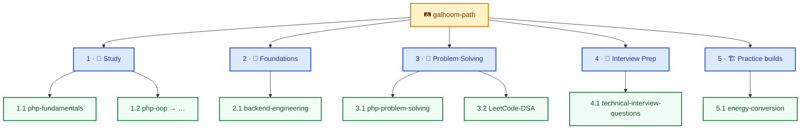
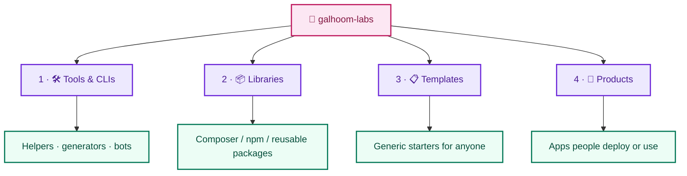

**Backend engineer** — PHP, Laravel, REST APIs, domain logic for production backends.

[🔗 LinkedIn](https://www.linkedin.com/in/abdelrahman-galhoom/)

---

I ship backend APIs and Laravel apps. This page is the overview; depth lives in each org.

## Two homes (clear split)

| Org | Promise | What belongs there |
|---|---|---|
| **[galhoom-path](https://github.com/galhoom-path)** | **Learn and progress** | Study, foundations, DSA, interview prep, practice builds |
| **[galhoom-labs](https://github.com/galhoom-labs)** | **Build and share useful things** | Tools, CLIs, products *(libraries & templates later)* |

Practice projects (e.g. Track 5) stay on **Path**. Only things meant for other people to *use* go to **Labs**.

---

### 🛤️ Galhoom Path — learn and progress

**[Open galhoom-path →](https://github.com/galhoom-path)**

---

### 🧪 Galhoom Labs — build and share useful things

**[Open galhoom-labs →](https://github.com/galhoom-labs)**

---

**Stack:** `PHP` · `Laravel` · `MySQL` · `REST APIs` · `Livewire` · `Filament` · `Git` · `Postman`
