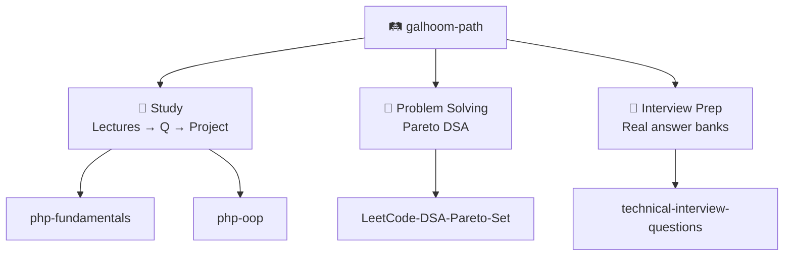

# Abdelrahman Galhoom

**Software engineer** · **Backend specialist** · Egypt

I debug backends like a **detective**. **T-shaped** skills. **Product-engineer** mindset.

[LinkedIn](https://www.linkedin.com/in/abdelrahman-galhoom/) · [🛤️ Galhoom Path](https://github.com/galhoom-path)

---

## 🔭 Now

Shipping an **Energy Conversion & Metering** API (Laravel) — Clean Architecture, SOLID, real domain flows.

---

## 🛤️ Galhoom Path

→ [github.com/galhoom-path](https://github.com/galhoom-path)

---

## 🛠️ Stack

`PHP 8.5` · `Laravel 13` · `MySQL` · `Livewire` · `Filament` · `Git` · `Postman`

Pinned below: shipped backends + Galhoom Path.
