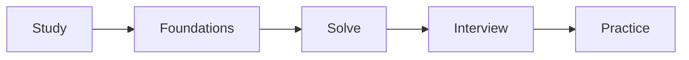
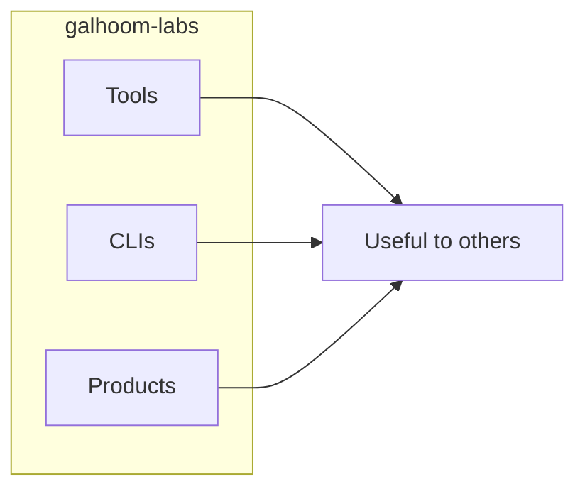

# Abdelrahman Galhoom

Backend-focused developer. Two public homes for work:

## Galhoom Path — Learn and progress

Ordered learning pipeline. Study → Foundations → Solve → Interview → Practice.

→ **[galhoom-path](https://github.com/galhoom-path)**

## Galhoom Labs — Build and share useful things

Real tools, CLIs, and products people can use. (Libraries & templates deferred for now.)

→ **[galhoom-labs](https://github.com/galhoom-labs)**

| | Path | Labs |
|---|---|---|
| **Promise** | Learn and progress | Build and share useful things |
| **Audience** | You following the path | Anyone who needs the thing |
| **For now** | Study · Foundations · Solve · Interview · Practice | Tools · CLIs · Products |
