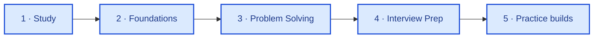

**Backend engineer** — PHP, Laravel, REST APIs, domain logic for production backends.

[🔗 LinkedIn](https://www.linkedin.com/in/abdelrahman-galhoom/) · [🛤️ Galhoom Path](https://github.com/galhoom-path)

---

I ship backend APIs and Laravel apps. Public craft work lives in **[galhoom-path](https://github.com/galhoom-path)** — this profile stays work-facing.

| | Repo | What |
|:---:|:---|:---|
| **1** | [energy-conversion](https://github.com/galhoom-path/energy-conversion) | Metering & billing API (Laravel) |
| **2** | [job-board-platform](https://github.com/Galhoom22/job-board-platform) | Recruitment platform |
| **3** | [technical-interview-questions](https://github.com/galhoom-path/technical-interview-questions) | PHP / Laravel interview answers |
| **4** | [backend-engineering](https://github.com/galhoom-path/backend-engineering) | Stack-agnostic backend notes |

Pipeline detail & progress → [galhoom-path](https://github.com/galhoom-path)

**Stack:** `PHP` · `Laravel` · `MySQL` · `REST APIs` · `Livewire` · `Filament` · `Git` · `Postman`
