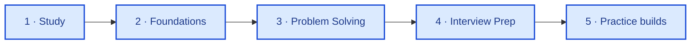
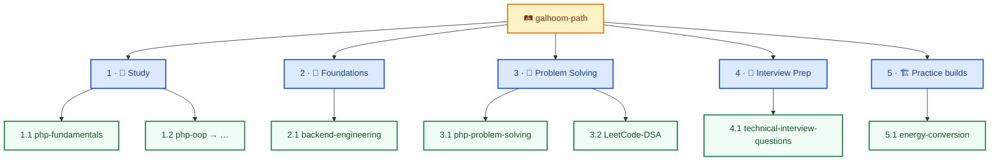

**Backend engineer** — PHP, Laravel, REST APIs, and domain logic for production backends.

[🔗 LinkedIn](https://www.linkedin.com/in/abdelrahman-galhoom/) · [🛤️ Galhoom Path](https://github.com/galhoom-path)

---

### Contents

| # | Section |
|:---:|:---|
| **1** | [What I ship](#1--what-i-ship) |
| **2** | [Selected work](#2--selected-work) |
| **3** | [Galhoom Path](#3--galhoom-path) |
| **4** | [Stack](#4--stack) |

---

## 1 · What I ship

I build and maintain **backend systems** — APIs, domain rules, and Laravel apps that have to stay correct under real traffic and changing requirements.

Right now that means:
- Production-style **API and domain work** (metering, billing, hiring flows)
- Keeping a public **backend craft org** ([galhoom-path](https://github.com/galhoom-path)) for structured notes, interview depth, and practice builds — details live there, not on this profile

---

## 2 · Selected work

Work first. Path curricula are optional reading — not a “student status” board.

| # | Repository | Kind | What it is |
|:---:|:---|:---|:---|
| **1** | [energy-conversion](https://github.com/galhoom-path/energy-conversion) | Practice build · API | Energy metering & billing — meters, tariffs, reconciliation (Laravel) |
| **2** | [job-board-platform](https://github.com/Galhoom22/job-board-platform) | Personal · product | Recruitment platform — candidate & company hiring flows |
| **3** | [technical-interview-questions](https://github.com/galhoom-path/technical-interview-questions) | Interview depth | PHP / Laravel answers drawn from real interview rounds |
| **4** | [backend-engineering](https://github.com/galhoom-path/backend-engineering) | Foundations | Stack-agnostic backend notes (HTTP, data, design trade-offs) |
| **5** | [php-fundamentals](https://github.com/galhoom-path/php-fundamentals) · [php-oop](https://github.com/galhoom-path/php-oop) | Craft curricula | Living PHP series I maintain under Galhoom Path (versioned in place) |

> Full progress, track IDs, and study-method rules → **[galhoom-path](https://github.com/galhoom-path)** organization profile.

---

## 3 · Galhoom Path

Public org for **backend craft** — deliberate practice, interview depth, and practice builds. This profile stays engineer-facing; the org carries the pipeline detail.

| Track # | Track | Role |
|:---:|:---|:---|
| **1** | 📘 Study | Deep, versioned PHP curricula *(not a beginner badge — living reference + deliberate practice)* |
| **2** | 🧭 Foundations | Shared backend concepts |
| **3** | 🧠 Problem Solving | PHP gates → LeetCode patterns |
| **4** | 🎤 Interview Prep | Real interview answers |
| **5** | 🏗️ Practice builds | Public learn-by-doing APIs (requirements-first · not market products) |

> Track **5** is public **practice** (not commercial products). Real client/company work stays private.  
> Org homepage for IDs, progress, and method → [github.com/galhoom-path](https://github.com/galhoom-path)

[Open organization →](https://github.com/galhoom-path) · [Path progress →](https://github.com/galhoom-path#2--path-progress)

---

## 4 · Stack

`PHP` · `Laravel` · `MySQL` · `REST APIs` · `Livewire` · `Filament` · `Git` · `Postman`
